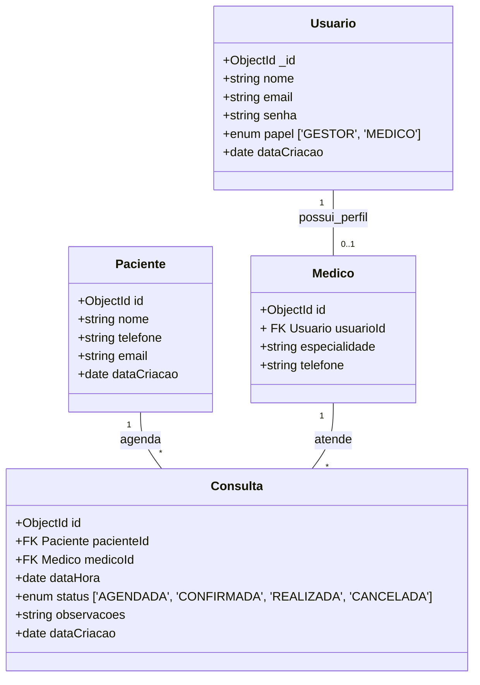

# Sistema de agendamento de consultas - "Saúde & Bem Estar"

Realizado por Larissa Nicodemo e Larissa Vieira

Prototipagem Link: https://stitch.google.com/projects/14449674919473421590 

## Desafio
A tarefa é analisar o briefing, entender o problema de negócio e adaptar o projeto-base para criar uma solução sob medida (MVP - Mínimo Produto Viável) que atenda às necessidades essenciais do cliente.
    Cliente Fictício: "Clínica Saúde & Bem-estar"
    O Problema: A secretária gerencia a agenda dos médicos em um caderno, o que causa rasuras, erros e dificulta o reagendamento.
    Público-Alvo:
    Recepcionista (Gestor): Tem acesso à agenda de todos os médicos, pode cadastrar pacientes e agendar/remarcar/cancelar consultas para eles.
    Médico: Vê apenas a sua própria agenda de consultas do dia/semana.
    Requisitos Essenciais (MVP):
    CRUD para Pacientes (nome, telefone).
    CRUD para Médicos (com sua especialidade).
    Sistema para criar Consultas, associando um paciente, um médico, data e hora.
    Validação para não permitir agendamentos em horários já ocupados para o mesmo médico.
    Diferencial Sugerido (Bônus): Um campo de status na consulta (Agendada, Confirmada, Realizada). 

## 1. Introdução
O presente documento especifica o planejamento e arquitetura para o desenvolvimento do Mínimo Produto Viável (MVP) do Sistema de Agendamento de Consultas da Clínica Saúde & Bem-estar. O objetivo principal é digitalizar o processo de agendamento manual da recepção, eliminando rasuras, erros de marcação e conflitos de horários na agenda dos médicos.

## 2. Requisitos
### 2.1 Requisitos Funcionais
| ID | Requisito | Descrição | 
| --- | --- | --- | 
| RF01 | Autenticação de usuários |  O sistema deve permitir que usuários (Recepcionistas e Médicos) façam login utilizando e-mail e senha. | 
| RF02 | Controle de acesso por Perfil | Usuários com o papel GESTOR (Recepcionista) devem ter acesso total a cadastros e agendamentos e os com o papel MEDICO devem ter acesso restrito apenas à sua própria agenda. | 
| RF03 | CRUD de Pacientes | O Gestor deve poder cadastrar, listar, editar e remover pacientes | 
| RF04 | CRUD de Médicos | O Gestor deve poder cadastrar, listar, editar e remover médicos | 
| RF05 | Criar Agendamento | O Gestor deve poder agendar consultas selecionando um Paciente, um Médico, uma Data e um Horário. | 
| RF06 | Validação de Concorrência de Horário | O sistema não deve permitir a criação de dois agendamentos para o mesmo médico na mesma data e horário. | 
| RF07 |  Gestão de Agendamentos | O Gestor deve poder alterar o horário ou cancelar agendamentos existentes. | 
| RF08 | Visualização de Agenda Geral | O Gestor deve ter uma visão consolidada de todas as consultas da clínica, com filtros por médico e data. | 
| RF09 | Visualização de Agenda individual | O Médico deve visualizar exclusivamente suas consultas do dia ou da semana. | 
| RF10 | Atualização de Status da Consulta | O Médico (ou Gestor) deve poder atualizar o status da consulta para: AGENDADA, CONFIRMADA, REALIZADA ou CANCELADA. | 

### 2.2 Requisitos Não Funcionais

| ID | Requisito | Descrição | 
| --- | --- | --- | 
| RNF01 | Criptografia de Senhas | Todas as senhas devem ser salvas no banco de dados em formato hash utilizando Bcrypt. | 
| RNF02 | Autenticação Segura via JWT | A sessão do usuário deve ser mantida por meio de um token JWT (JSON Web Token) seguro enviado nas requisições. | 
| RNF03 | Proteção de Endpoints | As APIs do backend devem validar o token e o perfil do usuário antes de processar qualquer requisição restrita. | 
| RNF04 | Unicidade no Banco de Dados | O banco de dados (MongoDB) deve garantir a consistência de horários através de um índice composto único (medicoId + dataHora). | 
| RNF05 | Padronização de Datas (UTC) | Todas as datas e horas devem ser armazenadas e trafegadas no padrão ISO 8601 / UTC para evitar divergências de fuso horário. | 
| RNF06 | Tecnologia FrontEnd/ Backend | A aplicação deve ser desenvolvida utilizando o framework Next.js com a arquitetura App Router. | 
| RNF07 | Mapeamento ODM | A interação com o banco de dados MongoDB deve ser feita através da biblioteca Mongoose. | 
| RNF08 | Arquitetura de Estilos | A interface gráfica deve utilizar SCSS / SASS modularizado para a estilização dos componentes. | 
| RNF09 | Usabilidade | A interface deve ser simples, limpa e intuitiva, facilitando o uso rápido pela recepção durante o atendimento telefônico ou presencial. | 

## 3.Diagrama de Casos de Uso

**Usuários:**
- Recepcionista: Responsável por todo o fluxo operacional da clínica.
- Médico: Usuário especialista com acesso focado em suas próprias consultas.

**Casos de uso por usuário:**
- Recepcionista (Gestor):
    - UC01 - Cadastrar/Editar/Listar/Excluir Paciente
    - UC02 - Cadastrar/Editar/Listar/Excluir Médico (definindo especialidade)
    - UC03 - Agendar Consulta (valida disponibilidade de horário)
    - UC04 - Remarcar/Cancelar Consulta
    - UC05 - Visualizar Agenda Geral (todos os médicos e horários)

- Médico: 
    - UC06 - Visualizar Minha Agenda (somente suas consultas por dia/semana)
    - UC07 - Atualizar Status da Consulta (Agendada, Confirmada, Realizada, Cancelada)

## 4. Diagrama de Classes

## 5. Análise de Riscos 

| ID | Risco | Impacto | Estratégia de Mitigação | 
| --- | --- | --- | --- |
| R01 | Agendamento Duplo | Alto | Implementar validação no backend antes da gravação e criar um índice composto único no MongoDB (medicoId + dataHora). | 
| R02 | Acesso Não Autorizado de Dados | Alto | Aplicar middlewares no Next.js validando o Role (GESTOR vs MEDICO) armazenado no Token JWT em rotas protegidas. | 
| R03 | Inconsistência de Fuso Horário | Médio | Padronizar todas as datas/horas enviadas e armazenadas no formato ISO 8601 (UTC) no banco de dados. |
| R04 | Incompatibilidade com Projeto-Base | Médio | Estudar a estrutura do código legado na primeira etapa e realizar adaptações incrementais nas rotas e nos Schemas. |

## 6. Casos de Teste

| ID | Funcionalidade | Ação | Resultado Esperado | Critério de Sucesso | 
| --- | --- | --- | --- | --- |
| CT01 | Validação de Concorrência | Tentar agendar 2 consultas para o mesmo medicoId na mesma dataHora. | O sistema deve rejeitar o segundo agendamento. | Retorno HTTP 409 Conflict e mensagem clara de erro no formulário. | 
| CT02 | Isolamento de Visão do Médico | Acessar rota de agenda logado com usuário de perfil MEDICO. | Exibir apenas as consultas vinculadas ao medicoId do usuário logado. | Nenhum dado de outros médicos deve ser retornado na resposta da API. |
| CT03 | Proteção de Rotas Gestoras | Tentar cadastrar novo médico logado como MEDICO. | Bloqueio de acesso no middleware. | Retorno HTTP 403 Forbidden ou redirecionamento automático para a tela de login/dashboard. | 
| CT04 | Atualização de Status | Alterar status da consulta para REALIZADA. | Atualizar o campo status no documento no MongoDB. | Estado refletido em tempo real na interface da agenda. | 
